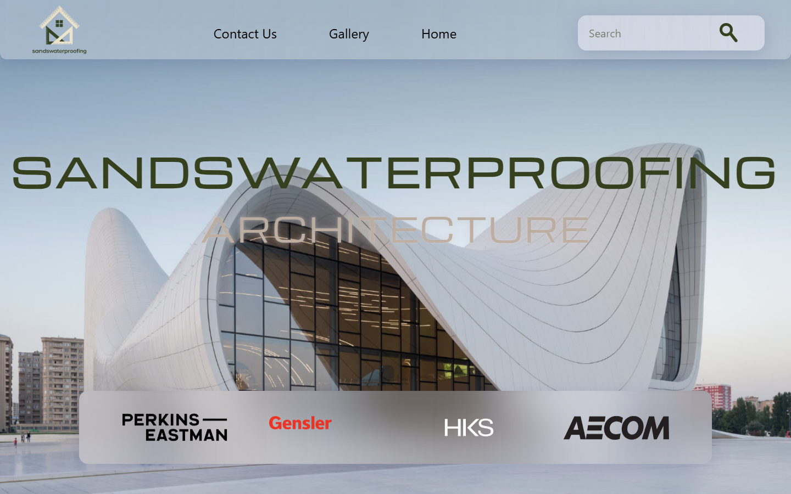

# Sands Waterproofing

An unfinished architecture-branded presentation website built with Next.js,
React, Tailwind CSS and Framer Motion.



**Status:** visual prototype at application revision `557a8cb`. It contains a
photographic hero, a brand section with animated geometry and an unfinished
creation section. The header's Gallery/Contact labels have no destinations,
and search has no results handler. There is no contact service or customer
database in this checkout. Client engagement, individual contribution and the
relationships implied by displayed company logos have not been confirmed.

## Run locally

Verified on Windows with Node.js 24.11.1 and npm 11.6.2. The lockfile pins
Next.js 16.0.1 and React 19.2.0. No application credentials or external backend
are required; Google font downloads need network access during the build.

```sh
git clone https://github.com/boyInShadows/sandswaterproofing.git
cd sandswaterproofing
npm ci
npm run dev
```

Open <http://localhost:3000>. Production preview and existing checks:

```sh
npm run lint
npm run build
npm start
```

The [page composition](app/components/main/index.js) and
[hero](app/components/main/heroSection/index.js) show the implemented scope.
Newer uncommitted changes in the maintainer's original checkout are excluded
from this presentation and remain separate work.

## Verification and limits

On 2026-10-30, a clean locked install, lint and production build passed. Edge
loaded desktop and emulated mobile views without page errors or broken images.
Mobile still has overlapping header controls and clipped oversized headings;
it is not a finished responsive layout. The browser title also remains the
framework placeholder. No live deployment, complete accessibility or physical
device acceptance is claimed.

A dated npm audit reported 18 dependency advisories (1 critical, 12 high,
4 moderate, 1 low). Dependencies were not upgraded. There is no test script or
quality CI. The screenshot is an actual local render of already-public assets;
asset rights and existing credits remain unchanged, and no license is assigned
by this documentation update.
